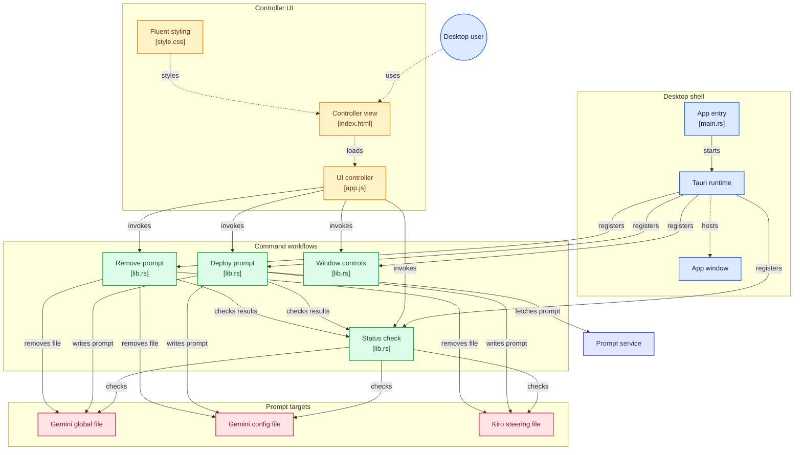

<p align="center">
  
</p>

<p align="center">
  <h1 align="center">⚡ ANTIGRAVITY NEXUS</h1>
  <p align="center"><strong>Modern, Yerel ve Ultra Hafif IDE Kontrol & Senkronizasyon Merkezi</strong></p>
  <p align="center">
    <a href="https://www.rust-lang.org/"></a>
    <a href="https://tauri.app/"></a>
    <a href="#"></a>
    <a href="#"></a>
    <a href="#"></a>
  </p>
</p>

---

<p align="center">
  
</p>

---

## 🌟 Öne Çıkan Özellikler

- 💎 **Windows 11 Fluent Acrylic Dark Arayüz:** Modern buzlu cam efekti (`backdrop-filter: blur`), Plus Jakarta Sans ve JetBrains Mono tipografisi.
- ⚡ **Sıfır Konsol, Bağımsız Yerel Binary:** `windows_subsystem = "windows"` yönergesi ile arka planda siyah konsol penceresi açılmaz; tamamen temiz masaüstü uygulamasıdır.
- 📡 **Canlı Durum Takipçisi (Live HUD):**
  - `~/.gemini/GEMINI.md` (Antigravity Global)
  - `~/.gemini/config/gemini.md` (Config Steering)
  - `~/.kiro/steering/prompt.md` (Kiro Steering)
  Hedef yapılandırmaları dinamik tarar ve aktiflik durumunu rozetlerle gösterir.
- 🚀 **Tek Tıkla Deploy & Geri Alma:**
  - **Aktifleştir (Deploy Nexus):** Uzak prompt çekirdeğini çeker ve hedeflere senkronize eder.
  - **Sıfırla & Temizle:** Tüm bypass dosyalarını anında temizler ve sistemi fabrika ayarlarına döndürür.

---

## 🏛️ Mimari Akış Şeması



---

## 📦 Kurulum ve Çalıştırma

Kök dizinde bulunan hazır derlenmiş yürütülebilir dosyayı doğrudan çalıştırabilirsiniz:
- 👉 **[`AntigravityNexus.exe`](./AntigravityNexus.exe)**

### 🛠️ Geliştirici Olarak Derleme

Gereksinimler: [Rust & Cargo](https://rustup.rs/) (Sistemde hazır kuruludur).

#### 1. Geliştirici Modunda Çalıştırma:
```powershell
cd src-tauri
cargo run
```

#### 2. Konsolsuz Release EXE Derleme:
```powershell
cd src-tauri
cargo build --release
```
Derlenen dosya `src-tauri/target/release/antigravity-nexus.exe` konumunda üretilir ve kök dizine kopyalanabilir.
