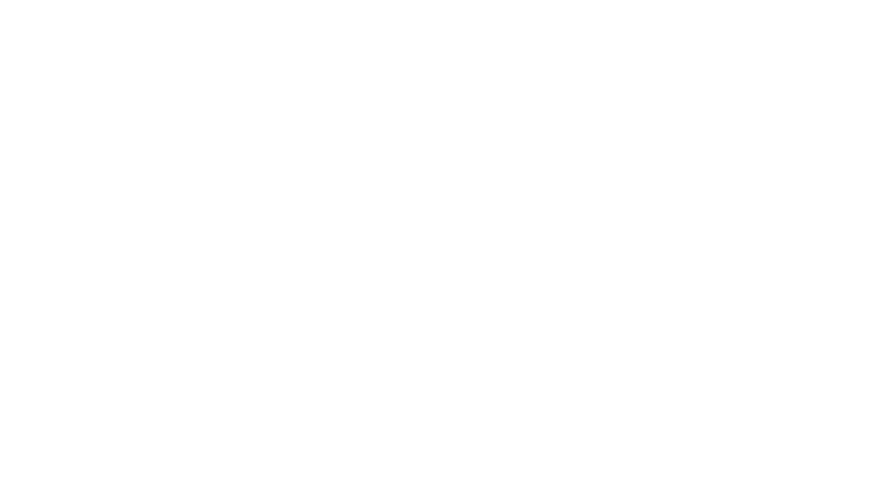

<p align="center">
  
</p>

<p align="center">
  <h1 align="center">⚡ ANTIGRAVITY NEXUS</h1>
  <p align="center"><strong>Modern, Yerel ve Ultra Hafif IDE Kontrol & Senkronizasyon Merkezi</strong></p>
  <p align="center">
    <a href="https://www.rust-lang.org/"></a>
    <a href="https://tauri.app/"></a>
    <a href="#"></a>
    <a href="#"></a>
    <a href="#"></a>
  </p>
</p>

---

<p align="center">
  
</p>

---

## 🌟 Öne Çıkan Özellikler

- 💎 **Windows 11 Fluent Acrylic Dark Arayüz:** Modern buzlu cam efekti (`backdrop-filter: blur`), Plus Jakarta Sans ve JetBrains Mono tipografisi.
- ⚡ **Sıfır Konsol, Bağımsız Yerel Binary:** `windows_subsystem = "windows"` yönergesi ile arka planda siyah konsol penceresi açılmaz; tamamen temiz masaüstü uygulamasıdır.
- 📡 **Canlı Durum Takipçisi (Live HUD):**
  - `~/.gemini/GEMINI.md` (Antigravity Global)
  - `~/.gemini/config/gemini.md` (Config Steering)
  - `~/.kiro/steering/prompt.md` (Kiro Steering)
  Hedef yapılandırmaları dinamik tarar ve aktiflik durumunu rozetlerle gösterir.
- 🚀 **Tek Tıkla Deploy & Geri Alma:**
  - **Aktifleştir (Deploy Nexus):** Uzak prompt çekirdeğini çeker ve hedeflere senkronize eder.
  - **Sıfırla & Temizle:** Tüm bypass dosyalarını anında temizler ve sistemi fabrika ayarlarına döndürür.

---

## 🏛️ Mimari Akış Şeması

```mermaid
flowchart TB
  subgraph shell["Çekirdek Kabuk (Core Shell)"]
    main["main.rs<br/>windows_subsystem · WinMain · Uygulama Girişi"]
    runtime["Tauri Runtime<br/>Wry · Webview2 Motoru · Olay Döngüsü"]
    window["Pencere Yöneticisi<br/>Çerçevesiz Pencere · Akrilik Efekt · 440x650"]
  end

  subgraph ui["Modern Fluent Arayüz (Frontend UI)"]
    view["index.html<br/>Fluent DOM Hiyerarşisi · Radar HUD · Hedef Kartları"]
    style["style.css<br/>Acrylic Cam Efekti · Glow Geçişleri · Plus Jakarta Sans"]
    app["app.js<br/>Tauri IPC invoke Köprüsü · Canlı Rozet Güncelleme · Olaylar"]
  end

  subgraph core["Çekirdek Modüller & Komutlar (Rust Backend)"]
    chk["check_status<br/>Hedef Dosya Varlık Denetimi"]
    act["activate_bypass<br/>Uzak Prompt İndirme & Dağıtım Motoru"]
    deact["deactivate_bypass<br/>Hedefleri Temizleme & Sıfırlama"]
    wctrl["close_app / minimize_app<br/>Özel Pencere Kontrolleri"]
  end

  subgraph os["Hedef Dosya Sistemi & Ağ Yüzeyleri"]
    g_global["~/.gemini/GEMINI.md<br/>Antigravity Global Prompt"]
    g_conf["~/.gemini/config/gemini.md<br/>Antigravity Config Steering"]
    k_steer["~/.kiro/steering/prompt.md<br/>Kiro Steering Kuralı"]
    remote["Uzak API / Bulut Prompt Deposu<br/>HTTPS Çekirdek Kuralı"]
  end

  main --> runtime
  runtime --> window
  runtime --> core
  window --> ui

  view --> app
  style --> view
  app -->|invoke: check_status| chk
  app -->|invoke: activate_bypass| act
  app -->|invoke: deactivate_bypass| deact
  app -->|invoke: close / minimize| wctrl

  act --> remote
  act --> g_global
  act --> g_conf
  act --> k_steer

  deact --> g_global
  deact --> g_conf
  deact --> k_steer

  chk -.->|Canlı Varlık Kontrolü| g_global
  chk -.->|Canlı Varlık Kontrolü| g_conf
  chk -.->|Canlı Varlık Kontrolü| k_steer
```

---

## 📦 Kurulum ve Çalıştırma

Kök dizinde bulunan hazır derlenmiş yürütülebilir dosyayı doğrudan çalıştırabilirsiniz:
- 👉 **[`AntigravityNexus.exe`](./AntigravityNexus.exe)**

### 🛠️ Geliştirici Olarak Derleme

Gereksinimler: [Rust & Cargo](https://rustup.rs/) (Sistemde hazır kuruludur).

#### 1. Geliştirici Modunda Çalıştırma:
```powershell
cd src-tauri
cargo run
```

#### 2. Konsolsuz Release EXE Derleme:
```powershell
cd src-tauri
cargo build --release
```
Derlenen dosya `src-tauri/target/release/antigravity-nexus.exe` konumunda üretilir ve kök dizine kopyalanabilir.
